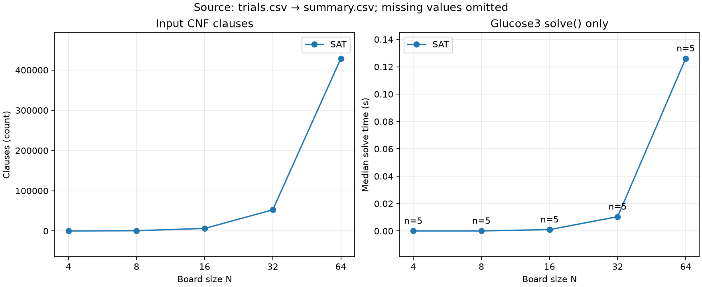
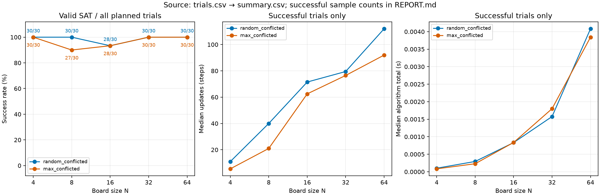
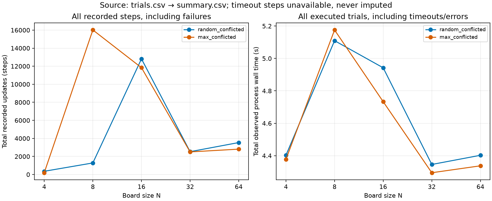

# Benchmark Task 1 — main-experiment

Nguồn dữ liệu: [trials.csv](trials.csv). Bảng tổng hợp: [summary.csv](summary.csv).
Cấu hình: [config.json](config.json). Môi trường và provenance: [metadata.json](metadata.json).
Commit mã nguồn: `2781502d6e92eefda54fdb6c772c8d65a40c0330`; working tree dirty khi bắt đầu: `False`.
Máy: Intel(R) Core(TM) i7-14650HX; Windows-11-10.0.26200-SP0; Python 3.12.10.
Kiểm tra dữ liệu: 325 lượt theo kế hoạch, 318 nghiệm hợp lệ; audit đạt.

Chưa chạy (NOT_RUN): 0 lượt, lý do nếu có là hết ngân sách toàn phiên.
Đã bắt đầu nhưng bị dừng bởi deadline (TIMEOUT): 0 lượt.
Lỗi (ERROR): 0 lượt. Lý do từng lượt nằm ở cột message của trials.csv;
timeout không phải kết luận vô nghiệm và không có tổng thời gian thuật toán hoàn tất.

## Thiết kế

SAT: 5 lượt/N, không warmup, timeout 15 s/lượt.
Min-Conflicts: 30 seed/N/chiến lược, max_steps=5000,
timeout 5 s/lượt, không restart. Mỗi cặp dùng cùng seed và bản sao cùng trạng thái đầu;
thứ tự hai chiến lược luân phiên theo lượt. Một worker tại một thời điểm, ngân sách toàn phiên 600 s.

## SAT

Trung vị solve chỉ đo lời gọi Glucose3.solve(), đơn vị giây; không gồm sinh CNF/nạp solver.
n solve là số lượt có phép đo solve hoàn tất, kể cả nếu giai đoạn sau bị lỗi/timeout.
Timeout trong solve không có thời gian solve hoàn tất và không được thay bằng thời gian timeout.

| N | Biến | Mệnh đề | Median solve (s) | n solve | SAT hợp lệ | Timeout | Lỗi | Chưa chạy |
| --- | --- | --- | --- | --- | --- | --- | --- | --- |
| 4 | 16 | 80 | 1.69e-05 | 5 | 5 | 0 | 0 | 0 |
| 8 | 64 | 736 | 5.09e-05 | 5 | 5 | 0 | 0 | 0 |
| 16 | 256 | 6336 | 0.0010066 | 5 | 5 | 0 | 0 | 0 |
| 32 | 1024 | 52608 | 0.0104434 | 5 | 5 | 0 | 0 | 0 |
| 64 | 4096 | 428800 | 0.126074 | 5 | 5 | 0 | 0 | 0 |

## Min-Conflicts

Tỷ lệ thành công = SAT hợp lệ / tổng lượt được lên kế hoạch. Bảng luôn giữ số lượt chưa chạy nếu có.
Trung vị bước/thời gian bên dưới chỉ trên các lượt thành công, có số mẫu đi kèm; không có thành công dùng N/A.
Thời gian thuật toán tính cả chọn biến, chọn hàng, cập nhật, khởi tạo RNG/board, kiểm tra và thống kê.

| N | Chiến lược | Thành công | Tổng lượt | Tỷ lệ | Median bước | n bước | Median thuật toán (s) | n thời gian |
| --- | --- | --- | --- | --- | --- | --- | --- | --- |
| 4 | max_conflicted | 30 | 30 | 1 | 5.5 | 30 | 8.345e-05 | 30 |
| 8 | max_conflicted | 27 | 30 | 0.9 | 21 | 27 | 0.0002289 | 27 |
| 16 | max_conflicted | 28 | 30 | 0.933333 | 62.5 | 28 | 0.00083585 | 28 |
| 32 | max_conflicted | 30 | 30 | 1 | 76.5 | 30 | 0.0018007 | 30 |
| 64 | max_conflicted | 30 | 30 | 1 | 92 | 30 | 0.00384305 | 30 |
| 4 | random_conflicted | 30 | 30 | 1 | 11 | 30 | 0.00010115 | 30 |
| 8 | random_conflicted | 30 | 30 | 1 | 40 | 30 | 0.0002939 | 30 |
| 16 | random_conflicted | 28 | 30 | 0.933333 | 71.5 | 28 | 0.0008326 | 28 |
| 32 | random_conflicted | 30 | 30 | 1 | 79.5 | 30 | 0.00157595 | 30 |
| 64 | random_conflicted | 30 | 30 | 1 | 112 | 30 | 0.00408235 | 30 |

## Chi phí trên mọi lượt và thất bại

Wall quan sát bao gồm spawn/import, thuật toán, IPC và teardown, tính cả TIMEOUT và lỗi.
Đây không phải thời gian solve hoặc tổng thuật toán. Tổng thuật toán hoàn tất chỉ cộng các số đo có sẵn;
lượt timeout không có tổng thuật toán hoàn tất, nên báo số mẫu riêng và dùng wall để biểu diễn chi phí toàn bộ.
Số bước đã ghi có thể thiếu khi tiến trình bị dừng; không suy đoán bước chưa được báo.

| Phương pháp | Chiến lược | N | Hết bước/unknown | Timeout | Lỗi | Chưa chạy | Tổng bước đã ghi | n bước | Tổng thuật toán hoàn tất (s) | n thuật toán | Tổng wall mọi lượt (s) | n wall |
| --- | --- | --- | --- | --- | --- | --- | --- | --- | --- | --- | --- | --- |
| min-conflicts | max_conflicted | 4 | 0 | 0 | 0 | 0 | 196 | 30 | 0.002731 | 30 | 4.37745 | 30 |
| min-conflicts | max_conflicted | 8 | 3 | 0 | 0 | 0 | 16017 | 30 | 0.110375 | 30 | 5.17582 | 30 |
| min-conflicts | max_conflicted | 16 | 2 | 0 | 0 | 0 | 11836 | 30 | 0.13248 | 30 | 4.73335 | 30 |
| min-conflicts | max_conflicted | 32 | 0 | 0 | 0 | 0 | 2504 | 30 | 0.057765 | 30 | 4.29481 | 30 |
| min-conflicts | max_conflicted | 64 | 0 | 0 | 0 | 0 | 2811 | 30 | 0.118105 | 30 | 4.33752 | 30 |
| min-conflicts | random_conflicted | 4 | 0 | 0 | 0 | 0 | 357 | 30 | 0.0031445 | 30 | 4.40264 | 30 |
| min-conflicts | random_conflicted | 8 | 0 | 0 | 0 | 0 | 1281 | 30 | 0.0096718 | 30 | 5.10966 | 30 |
| min-conflicts | random_conflicted | 16 | 2 | 0 | 0 | 0 | 12813 | 30 | 0.128458 | 30 | 4.94249 | 30 |
| min-conflicts | random_conflicted | 32 | 0 | 0 | 0 | 0 | 2530 | 30 | 0.0527127 | 30 | 4.34583 | 30 |
| min-conflicts | random_conflicted | 64 | 0 | 0 | 0 | 0 | 3539 | 30 | 0.128882 | 30 | 4.40247 | 30 |
| sat | N/A | 4 | 0 | 0 | 0 | 0 | N/A | 0 | 0.0014464 | 5 | 0.727331 | 5 |
| sat | N/A | 8 | 0 | 0 | 0 | 0 | N/A | 0 | 0.0034686 | 5 | 0.782996 | 5 |
| sat | N/A | 16 | 0 | 0 | 0 | 0 | N/A | 0 | 0.021165 | 5 | 0.816366 | 5 |
| sat | N/A | 32 | 0 | 0 | 0 | 0 | N/A | 0 | 0.140704 | 5 | 0.874026 | 5 |
| sat | N/A | 64 | 0 | 0 | 0 | 0 | N/A | 0 | 1.32735 | 5 | 2.09376 | 5 |

## Phạm vi và giới hạn

Timeout được parent thực thi từ trước spawn đến khi nhận kết quả, terminate/kill worker khi hết hạn;
wall quan sát còn gồm tối đa hai lần join 1 s và độ trễ lập lịch. Không chỉ kiểm tra thời gian sau khi solver trả về.
SAT gửi snapshot các pha hoàn tất để giữ số đếm và thời gian trước timeout; tổng SAT bao gồm chi phí callback/IPC,
còn từng pha CNF/nạp/solve không tính callback đó. Min-Conflicts total bao gồm chi phí chọn biến.
Các ô trống trong CSV là không có phép đo, không phải 0; summary.csv giữ ô trống, báo cáo hiển thị N/A.
Mọi TIMEOUT, ERROR, LIMIT_REACHED, NOT_RUN còn nguyên trong CSV. Xem audit.json và SHA256SUMS.txt để kiểm tra.
Đây là kết quả mô tả trên một máy, tập N/seed và ngân sách đã công bố. Không suy ra chiến lược tốt hơn nói chung;
trung vị trên lượt thành công chịu ảnh hưởng chọn mẫu, cần đọc cùng tỷ lệ thành công và chi phí toàn bộ.
Không so trực tiếp SAT solve với tổng thuật toán Min-Conflicts hoặc wall pipeline. Chưa kiểm tra macOS/Linux.
